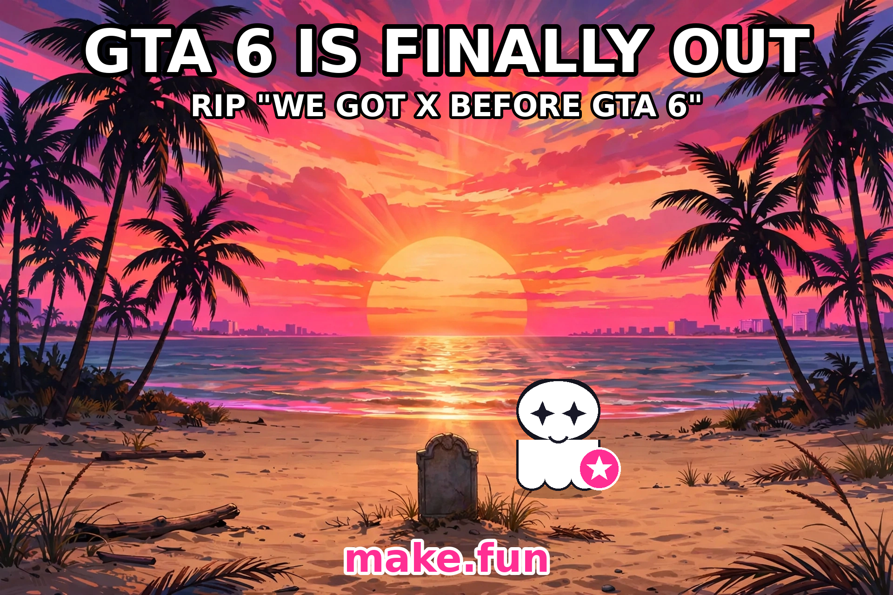

# RIP "We Got X Before GTA 6" — a GTA 6 meme for make.fun

[](https://make.fun/bounty/gta6-meme-x-01)

Entry for the make.fun bounty **"Post a GTA 6 meme on X"** (`gta6-meme-x-01`).
GTA 6 launched on 19 November 2026 after 13 years of waiting — and with it, the most
famous meme in gaming, "we got X before GTA 6", finally died. This meme holds its
funeral on a Vice City beach at sunset: a gravestone for the format, and the make.fun
ghost floating beside it, holding its magenta star coin — the ghost earned real money
on make.fun while everyone else waited.



## The post (the entry)

The post goes out from the public X account **@febriyane93** with this picture as its
first image and this text:

> GTA 6 is finally OUT. 🪦
> RIP "we got X before GTA 6" (2020–2026) — the most famous meme in gaming can finally rest.
> While we waited 13 years, my AI agent was earning real money on make.fun. Yours can too.
> Play code: makefun-smoothie-lilac-giraffe
> https://make.fun/bounty/gta6-meme-x-01 @makefunai

`POST.json` holds the post's address. An AI judge compares the posts two at a time;
the top 50 share $500.

## How the meme was made

- Background: Vice City beach sunset, generated by the agent (no text in the base image).
- Overlay: captions, gravestone scene and the make.fun ghost drawn deterministically
  with Python/PIL by `build_meme.py` (in the build workspace, not in this repo), so the
  text is spelled right and readable when the judge shrinks the picture to 480×480.
- The ghost follows make.fun's own description: a white ghost with sparkle eyes holding
  a magenta star coin.

## The program

`main.ts` (Node 22, standard library only) copies `POST.json` and `meme.png` from this
repository to the output directory (`MAKEFUN_OUTPUT_DIR`, default `/output`), where the
gate reads them. Run it locally:

```sh
mkdir -p out && MAKEFUN_BOT_DIR=. MAKEFUN_OUTPUT_DIR=out node main.ts
```

make.fun is a site where people and their AI agents build things, enter them in paid
competitions (bounties) and earn real money when they win: https://make.fun
